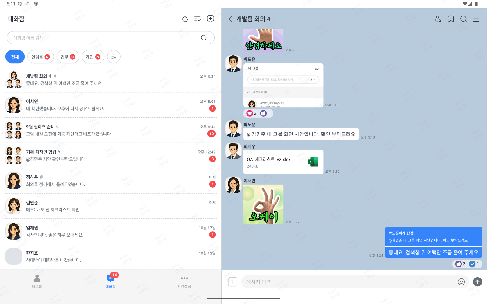
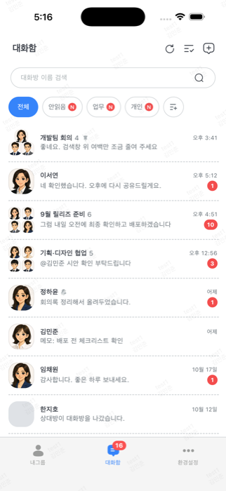
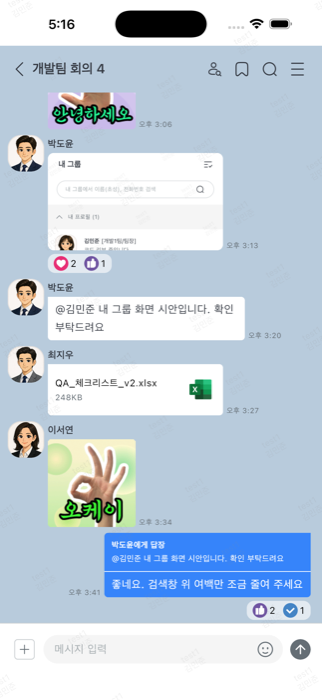
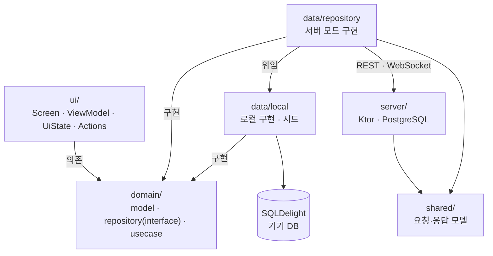
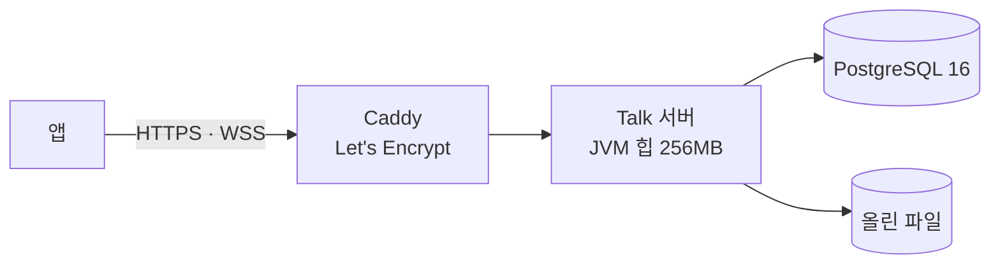
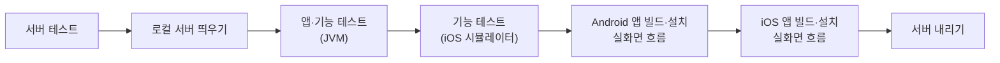

# Talk_Multiplatform

**Compose Multiplatform 으로 만든 Android · iOS 메신저 + Ktor 서버** — 서버 없이 기기 안 데이터만으로도, 서버에 붙어서도 동작합니다.


사내 메신저를 개발한 경험을 바탕으로 다시 만든 쇼케이스 프로젝트입니다. 두 가지 모드로 빌드됩니다.

- **로컬 모드** — 백엔드나 계정 없이 `installDebug` 한 번이면 실행됩니다. 대화·투표·공지가 기기 안 데이터베이스를 오가며 동작합니다.
- **서버 모드** — 같은 저장소의 Ktor 서버에 붙어 여러 사람이 실제로 주고받습니다. 화면과 도메인 계층은 로컬 모드와 같은 코드를 씁니다.

<p align="center">
  
  
  
</p>
<p align="center"><sub>태블릿은 대화함과 대화방을 나란히(폴더블도 같은 레이아웃), 폰은 한 화면씩. 사진 · 파일 · 이모티콘 · 답장 · 공감 · 멘션이 한 대화방에 보입니다.</sub></p>

---

## 주요 기능

### 대화
- 텍스트 · 이미지 · **동영상**(첫 프레임 썸네일 + 전체화면 재생) · 파일
- **이모티콘** — 정지/움직이는(GIF) 이모티콘, 탭 기억, 대화와 함께 전송
- **답장** — 스와이프 / 롱프레스, 원문 인용 후 원본으로 점프
- **전달** — 롱프레스 메뉴에서 글·이모티콘·사진·동영상·파일을 다른 방이나 사람에게. 첨부는 서버가 받을 방으로 복사해 그 방 사람만 받는다
- **멘션** — `@` 입력 시 참여자 자동완성, 멘션 수신 시 배지
- **공감(리액션)** — 같은 반응 재선택 시 토글 해제
- **공지** — 대화를 공지로 등록, 상단 배너(접기·숨기기), 전문 보기
- **투표** — 생성 · 참여 · 결과, 종료 시 1위 표시
- **책갈피** · **회수** · **검색**(사용자 · 날짜 필터)
- **AI 요약** — 문서 파일(txt·md·csv·pdf·docx·xlsx·pptx·hwp·hwpx 등) 롱프레스 메뉴에서 [AI Agent](#ai-agent-연동-ai-요약) 앱을 열어
  요약을 맡긴다. 서버 모드에서만 보인다

### 대화방
- 목록 · 그룹(칩) 관리 · 상단고정 · 알림 설정 · 나가기 · 초대(1:1 중복 생성 방지)
- **모아보기** — 서랍에서 방의 사진·동영상(화면 너비에 맞춘 그리드)과 파일을 탭으로 모아 보고, 누르면 대화방과 같이 연다
- 안읽음 마커, 새 대화 배너, 최신으로 이동

### 미디어
- 사진 선택 시트, **앨범 폴더별 필터**, 다중 선택, 전체화면 뷰어, 갤러리 저장

### 그 외
- 내그룹(연락처) · 사용자 프로필 · **화면잠금**(PIN / 패턴 / 생체) · 공유(Share Intent)
- **다크모드** · **태블릿 · 폴더블 2-pane** · 한국어/영어 (문자열 421개, 양쪽 완전 일치)
- **전송 주체 전환** — 로컬 모드에서는 상대 대화를 만들 수 없으므로, 보내는 사람을 바꿔 대화 흐름을 재현하는 시연용 기능 (서버 모드에서는 숨김)

---

## 기술 스택

| 분류 | 사용 기술 |
|---|---|
| 언어 · UI | Kotlin 2.3.20, Compose Multiplatform 1.11.1, Material3 |
| 아키텍처 | Clean Architecture (ui / domain / data), MVVM |
| DI | Koin 4.2.1 |
| 네비게이션 | Voyager 1.0.1 |
| 기기 DB | SQLDelight 2.3.2 (테이블 11개) — 서버 모드에서는 캐시로 쓴다 |
| 설정 저장 | multiplatform-settings 1.3.0 |
| 이미지 | Coil 3.4.0 (+ GIF 디코더) |
| 직렬화 · 시간 | kotlinx.serialization 1.11.0, kotlinx-datetime 0.6.1 |
| 네트워크 | Ktor 3.4.2 클라이언트 (REST · WebSocket) |
| 서버 | Ktor 3.4.2 (Netty · WebSocket), HikariCP, Flyway, PostgreSQL 16 |
| Firebase | Messaging(푸시) · Crashlytics — Android · iOS |
| Android 전용 | AndroidX Biometric |

**타깃** — Android `minSdk 24` / `targetSdk 36`, iOS `iosArm64` · `iosSimulatorArm64`

---

## 아키텍처



의존성은 **안쪽으로만** 흐릅니다. `domain` 은 `ui` · `data` 를 알지 못하고, Compose 타입도 쓰지 않습니다.
어느 구현을 쓸지는 Koin 모듈 한 곳에서 갈리므로, 서버를 붙이면서 화면과 도메인은 손대지 않았습니다.

```
composeApp/src/
├── commonMain/          387 files — 화면·도메인·데이터 대부분
│   ├── kotlin/com/eunilsung/talk/
│   │   ├── ui/          화면 (chatroom, chatroomlist, group, invite, setting …)
│   │   ├── domain/      model · repository(interface 15) · usecase(57)
│   │   ├── data/        local(플랫폼 추상화 · repository 로컬 구현 · seed 시드) · repository(서버 모드 구현) · remote/server · mapper
│   │   └── di/          Koin 모듈
│   ├── sqldelight/      AppDatabase.sq
│   └── composeResources/ strings(ko·en) · drawable
├── androidMain/          33 files — actual 구현
├── iosMain/              33 files — actual 구현
└── commonTest/           59 files — 로직 + DB 통합 + 서버 모드 저장소 + 기능 테스트
shared/                    3 files — 앱·서버가 함께 쓰는 요청·응답 모델
server/                   33 files — Ktor 서버 (+ 테스트 17 files, 마이그레이션 9개)
deploy/                   운영 배포 — Docker Compose(PostgreSQL · 서버 · Caddy) · 배포·서버 준비·백업 스크립트
.maestro/                 실화면 흐름 5개 — Android·iOS 에 같은 파일을 돌린다
```

**화면 패턴** — 10개 ViewModel 이 `sealed UiState` 를 노출하고, 9개 화면이 `sealed Actions` 로 이벤트를 단방향 전달합니다.

---

## 로컬 데이터 설계

서버가 없어도 "진짜처럼" 동작하게 만든 부분입니다.

- **`data/local/repository/`·`data/local/seed/`** — 서버 자리를 대신하는 저장소 구현 12개와 시드 데이터.
  시드는 계정 10명, 대화방 7개, 방마다 대화 스크립트로 구성되며 최초 실행 시 DB에 적재됩니다.
- **단일 출처** — 대화방 목록의 안읽음·멘션 수를 하드코딩하지 않고 **대화 스크립트에서 도출**합니다.
  목록엔 12인데 방엔 5개뿐인 어긋남을 구조적으로 막았고, 테스트로 고정했습니다.
- **실제 CRUD** — 대화 전송·공지 등록·투표·책갈피가 모두 SQLDelight 를 거칩니다. 앱 재시작 후에도 유지됩니다.
- 시드를 바꿀 땐 `Config.Database.NAME` 을 올려 새 DB 로 시작합니다.

---

## 서버 모드 설계

`local.properties` 에 `server.baseUrl` 을 넣고 빌드하면 서버 모드가 됩니다.

- **화면은 계속 기기 DB 를 봅니다.** 서버 모드 저장소는 로컬 구현 위에 얹혀(`by local` 위임),
  서버에서 받은 것을 기기 DB 에 반영하고 사용자가 한 일을 서버로 보냅니다. 오프라인에서도 받아 둔 목록이 보입니다.
- **완결된 응답만 반영합니다.** 요청이 실패하면 가지고 있던 데이터를 그대로 둡니다. 공감·회수·공지처럼
  여러 사람이 동시에 건드리는 것은 화면에 먼저 그리지 않고 서버가 받아 준 결과만 그립니다.
- **대화 순서는 서버가 매긴 번호가 정합니다.** 단말 시계가 어긋나도 순서가 뒤집히지 않습니다.
  대화 id 는 앱이 만들고 재전송에도 바꾸지 않아, 응답을 못 받아 다시 보내도 대화가 두 번 생기지 않습니다.
- **계산할 수 있는 값은 저장하지 않습니다.** 안읽음 수는 참여자별 "어디까지 읽었는지"에서, 득표수는 표에서 셉니다.
  목록과 방의 숫자가 어긋날 자리를 구조적으로 없앴습니다.
- **바꾸는 요청은 REST, 알림은 WebSocket.** 알림은 "무엇이 바뀌었다"만 전하고, 앱은 연결될 때마다 다시 조회해
  끊겨 있던 동안의 변화를 메웁니다. 연결이 끊겨도 요청이 사라지지 않습니다.
- **신원은 토큰이 정합니다.** 비밀번호는 PBKDF2 해시로, 토큰은 SHA-256 해시로만 서버에 남습니다.
  참여 중이 아닌 방은 없는 방과 똑같이 답합니다.

| 기능 | 서버가 지키는 것 |
|---|---|
| 대화방 | 1:1 방은 누가 먼저 열어도 하나, 나중에 초대받은 사람은 그 전 대화를 보지 못함 |
| 읽음 | 읽은 자리는 뒤로 가지 않음, 나간 사람은 안읽음 수에서 빠짐 |
| 공감 · 회수 | 켤지 끌지를 서버가 정함, 회수하면 본문·파일·공감이 누구에게도 나가지 않음 |
| 파일 | 방 참여자만 받을 수 있고 나가면 못 받음, 파일 하나 20MB |
| 투표 | 하나만 고르는 투표엔 한 표, 끝내기는 만든 사람만 |
| 푸시 | 로그아웃하면 그 기기의 푸시 토큰도 함께 지워짐, 알림을 끈 방은 보내지 않음 |
| AI | 방에 초대해 `@AI` 로 부르는 참여자, 말풍선 번역, 보내기 전 글 다듬기(교정·정중하게·간결하게). 부른 사람이 볼 수 있는 대화만 모델에 보냄 |
| 로그인 | 틀린 비밀번호가 연달아 5번이면 5분 잠금 |

푸시는 Firebase 서비스 계정 키를, AI 는 Google Gemini 키(`GEMINI_API_KEY`)를 서버에 넣어야 동작합니다. 키가 없으면 그 기능만 꺼지고 서버는 그대로 뜹니다.

### AI Agent 연동 (AI 요약)

문서 파일 대화를 길게 눌러 **AI 요약** 을 고르면 같은 기기의 AI Agent 앱(별도 저장소)을 링크로 엽니다. 요약은 AI Agent 가
같은 Talk 계정의 토큰으로 이 서버에서 파일을 받아 만듭니다. Talk 서버와 `:shared` 계약은 바뀌지 않습니다.

```
aiagent://summarize?fileId=<Talk 서버 파일 id>&fileName=<파일 이름>&userId=<로그인 아이디>&userName=<이름>
```

- 값은 모두 퍼센트 인코딩합니다(공백 `%20`, 한글은 UTF-8). Talk 는 로그인 아이디와 사용자 id 가 같은 값이라 AI Agent 가
  자기 로그인 계정과 바로 비교합니다 — 다르면 그 앱이 로그아웃하고 이 계정으로 로그인하라고 안내합니다.
- 말풍선은 기기에 받아 둔 경로만 들고 있어, 서버 파일 id 는 `ServerFileStore` 의 기록에서 찾습니다. 서버가 확정한 파일 대화마다
  `server_chat_file_<방 id>/<대화 id>` → 파일 id 를 적어 두고 그것을 먼저 씁니다. 같은 파일을 여러 방에 보내거나 전달해 경로 하나를
  id 여럿이 가리켜도, 한 방에서 회수하거나 나간 뒤 다른 방의 요약이 엉뚱한 id 로 가지 않게 하려는 것입니다. 이 기록이 없는 옛 대화만
  `server_file_<id>` → 경로를 거꾸로 훑습니다.
- 파일 id 를 찾지 못하면 "받는 중" 안내를, AI Agent 가 없으면 "설치되어 있지 않아요" 안내를 띄웁니다. 두 토스트에는 testTag 가 붙어
  실화면 흐름이 문구 대신 id 로 찾습니다.
- 링크는 아무 앱이나 부를 수 있지만 파일은 그 방 참여자의 토큰으로만 받을 수 있습니다(서버가 막습니다).
- Android 는 `ACTION_VIEW` 로 열고(받을 앱이 없으면 `ActivityNotFoundException`), iOS 는 `canOpenURL` → `openURL` 입니다.
  iOS 는 Info.plist 의 `LSApplicationQueriesSchemes` 에 `aiagent` 가 있어야 `canOpenURL` 이 답합니다.
- 메뉴는 `Config.ChatRoom.IS_AI_SUMMARY_ENABLED` 로 끄고, 대상 확장자는 `AI_SUMMARY_EXTENSIONS` 에 있습니다.

---

## 배포

`deploy/` 의 Docker Compose 로 PostgreSQL · 서버 · Caddy(자동 HTTPS)를 한 대에 띄웁니다. 메모리 1GB 인스턴스
(Oracle Cloud Always Free `VM.Standard.E2.1.Micro`)에서 돌도록 맞췄습니다.



- **빌드는 배포하는 PC 에서 합니다.** 1GB 에서는 Gradle 이 돌지 않아, `installDist` 로 만든 실행본만 올려 이미지로 감쌉니다.
- **비밀값은 서버의 `~/talk/.env` 에만 둡니다**(`deploy/.env.example`). 배포 스크립트는 이 파일을 건드리지 않습니다.
- **도메인이 없으면** `<공인 IP>.sslip.io` 를 `DOMAIN` 에 넣으면 그 이름으로 인증서를 받습니다.

처음 한 번 — 새 인스턴스(Ubuntu 24.04)를 준비합니다.

```bash
ssh ubuntu@<공인 IP> 'mkdir -p talk'
scp deploy/setup-host.sh deploy/backup.sh deploy/.env.example ubuntu@<공인 IP>:talk/
ssh ubuntu@<공인 IP> 'sudo bash talk/setup-host.sh'   # 스왑 2GB · Docker · iptables 80/443 · 매일 DB 백업
ssh ubuntu@<공인 IP> 'cp talk/.env.example talk/.env' # 또는 직접 만들고 DOMAIN · DB_PASSWORD 등을 채운다
```

클라우드 쪽 방화벽(Oracle Cloud 는 VCN 보안 목록)에서도 80·443 을 열어 둡니다.

배포 — 빌드 · 올리기 · 다시 띄우기 · `/health` 확인까지 한 번에 합니다.

```bash
DEPLOY_HOST=ubuntu@<공인 IP> DEPLOY_KEY=~/.ssh/<키 파일> deploy/deploy.sh
```

| `.env` 값 | 용도 |
|---|---|
| `DOMAIN` | HTTPS 인증서를 받을 이름 |
| `DB_PASSWORD` | PostgreSQL 비밀번호 (`openssl rand -hex 24`) |
| `GEMINI_API_KEY` · `AI_MODEL` | AI. 비우면 AI 만 꺼진다 |
| `FIREBASE_CREDENTIALS_B64` | Firebase 서비스 계정 JSON 을 base64 한 줄로. 비우면 푸시만 꺼진다 |

앱은 `local.properties` 의 `server.baseUrl=https://<DOMAIN>` 으로 빌드하면 배포한 서버에 붙습니다. iOS 푸시는 Apple 의 APNs
인증 키가 Firebase 프로젝트에 등록돼 있어야 옵니다.

---

## 테스트

**앱 211개 + 서버 112개, 진짜 서버에 붙여 도는 기능 테스트 22묶음(시나리오 51개), 그리고 Android·iOS 실화면 흐름 5개.**

```bash
./gradlew :composeApp:testDebugUnitTest   # 앱 (Android JVM)
./gradlew :composeApp:allTests            # 앱 양 플랫폼
./gradlew :server:test                    # 서버 (내장 PostgreSQL)

# 기능 테스트 — 앱의 실제 통신 코드로 서버에 붙어 돈다. 로컬 서버는 알아서 뜨고 끝나면 내려간다
# Android Studio 에서는 실행 구성 "기능테스트 (실 서버)" 를 고르고 실행 버튼을 누른다
./gradlew :composeApp:testDebugUnitTest -PfunctionalTest=true --tests "*functest*"

# 실화면 흐름 — 같은 Maestro 흐름을 에뮬레이터·시뮬레이터에서 실제로 눌러 본다. 기기 고르기·설치는 .maestro/run.sh
TALK_SERVER_BASE_URL=http://localhost:8090 ./gradlew :composeApp:e2eAndroid :composeApp:e2eIos

# 전체 검증 — 위 전부를 한 번에. Android Studio 실행 구성 "검증 - 전체 (실화면 포함)" 과 같다
TALK_SERVER_BASE_URL=http://localhost:8090 ./gradlew :composeApp:verifyAll -PfunctionalTest=true --continue
```

| 대상 | 내용 |
|---|---|
| 순수 로직 | 대화 미리보기 토큰, 멘션 태그, 참여자 목록 인코딩 |
| 로컬 저장소 | 그룹 CRUD, 대화방 나가기·고정, 공감 토글, 공지, 책갈피, 시드 정합성 |
| 서버 모드 저장소 | 서버 대역을 끼워 전송 중 → 완료·실패, 재연결 따라잡기, 실패 시 되돌리기, 파일 내려받기 |
| 서버 저장소 | 실제 PostgreSQL 쿼리로 방·읽음·공감·회수·투표·그룹 규칙 |
| 기능 테스트 | 앱의 실제 REST·WebSocket 코드로 진짜 서버에 붙어 로그인·대화방·대화·읽음·공감/회수/공지/책갈피·파일·투표·그룹·초대·AI 와 화면 7곳(대화방·대화함·로그인·투표·초대·내 그룹·프로필) ViewModel 의 상태를 끝에서 끝까지. 주소를 줬을 때만 돈다 |
| 서버 경로 | HTTP 와 WebSocket 을 거쳐 인증·권한·알림·푸시 대상 |
| 실화면 흐름 | Maestro 로 Android 에뮬레이터·iOS 시뮬레이터에서 로그인 실패·대화 주고받기와 공감·투표 만들고 참여하고 마감·방 나가기·문서 파일의 AI 요약 메뉴, AI 키가 있으면 번역·다듬기까지 실제로 누른다. 상대는 REST 스크립트가 움직이고, 화면에서 한 일이 서버에 남았는지도 확인한다 |

화면 하나씩 그려 보는 Compose UI 테스트는 넣지 않았습니다. **화면 로직은 ViewModel 을 진짜 서버에 붙여**
보고, 버튼과 액션의 연결은 실화면 흐름이 기기에서 직접 눌러 봅니다. 흐름은 화면 문구 대신
`TestTags` 의 이름으로 요소를 찾아 기기 언어와 상관없이 돕니다.

- 앱의 인메모리 DB는 플랫폼별로 갈립니다 — Android 는 `JdbcSqliteDriver(IN_MEMORY)`,
  iOS 는 `NativeSqliteDriver(inMemory = true)`. iOS 는 **이름이 같으면 DB가 공유돼**
  케이스끼리 상태가 새는 문제가 있어, 매번 다른 이름을 부여합니다.
- 서버 테스트는 **설치 없이 뜨는 내장 PostgreSQL** 로 운영과 같은 Flyway 마이그레이션을 돌립니다.
  도커도 DB 설치도 필요 없고, 마이그레이션이 깨지면 여기서 먼저 드러납니다.
- 서버 모드 저장소 테스트와 기능 테스트는 Android(JVM)와 iOS 시뮬레이터 양쪽에서 돕니다.

### 검증 환경 준비

서버 쪽은 설치할 것이 없습니다. 서버 테스트와 로컬 서버 모두 내장 PostgreSQL 로 뜨고, 검증이 로컬 서버를
띄웠다가 끝나면 내립니다. 필요한 것은 아래뿐입니다.

| 필요한 것 | 쓰는 곳 |
|---|---|
| JDK 17, Android SDK | 전부 |
| Xcode, iOS 시뮬레이터 | iOS 테스트와 iOS 실화면 흐름 |
| Android 에뮬레이터 | Android 실화면 흐름 |
| [Maestro](https://maestro.mobile.dev) | 실화면 흐름. `curl -fsSL https://get.maestro.mobile.dev \| bash` 로 설치 |
| Gemini API 키 (선택) | AI 단계. 없으면 그 단계만 건너뛰고 실패로 치지 않습니다. 키가 있을 때 `-PrequireAi=true` 를 주면 AI 를 꼭 확인합니다 |

새 Mac 에서는 이 순서로 준비합니다. 저장소에 없는 파일은 `local.properties` 하나뿐입니다(Firebase 설정 파일은 저장소에
들어 있습니다).

1. **클론** — `git clone https://github.com/EunilSung/Talk_Multiplatform.git`
2. **JDK 17** — Android Studio 에서 Settings → Build Tools → Gradle → Gradle JDK 를 17 로 고릅니다. 터미널에서 돌릴 때는
   `export JAVA_HOME=$(/usr/libexec/java_home -v 17)`.
3. **Android Studio 로 열기** — 처음 동기화하면 `local.properties` 에 `sdk.dir` 이 생깁니다. SDK Manager 에서
   Android Emulator·Platform-Tools 를 설치하고, Device Manager 에서 에뮬레이터(AVD)를 하나 만듭니다.
   이름은 `<sdk.dir>/emulator/emulator -list-avds` 로 확인합니다.
4. **Xcode** — 설치하고 한 번 실행해 추가 구성 요소와 iOS 시뮬레이터 런타임을 받습니다. 명령줄 도구가 Xcode 를 가리키게
   `sudo xcode-select -s /Applications/Xcode.app` 을 해 둡니다(명령줄 도구만 잡혀 있으면 iOS 빌드가 실패합니다).
   시뮬레이터 UDID 는 `xcrun simctl list devices available` 로 확인합니다.
5. **Maestro** — 위 표의 명령으로 설치하고, PATH 가 반영되도록 터미널을 새로 엽니다.
6. **`local.properties`** — 검증에 쓸 기기를 아래처럼 적습니다.
7. **첫 실행** — 실행 구성 `검증 - 전체 (실화면 포함)`. 처음에는 Gradle 의존성, 내장 PostgreSQL, iOS 패키지(Firebase)를
   내려받느라 평소(8분쯤)보다 오래 걸립니다.

기기는 꺼져 있으면 켜서 씁니다. 적지 않으면 실화면 흐름은 켜져 있는 에뮬레이터·iPhone 시뮬레이터 중 첫 번째를,
iOS 테스트는 Kotlin 이 고른 시뮬레이터를 씁니다. 실기기는 고르지 않습니다.

```properties
sdk.dir=<Android SDK 경로>
# 실화면 흐름이 쓸 에뮬레이터 이름 (예: A35_API35)
e2e.androidAvd=<에뮬레이터 이름>
# 실화면 흐름과 iOS 테스트가 쓸 시뮬레이터
e2e.iosDevice=<시뮬레이터 UDID 또는 이름>
```

`server.baseUrl` 은 평소 값 그대로 둬도 됩니다. 검증은 환경변수 `TALK_SERVER_BASE_URL` 로 앱을 로컬 서버
주소(`http://localhost:8090`)에 붙여 빌드하고, Android 는 `adb reverse` 로 에뮬레이터에서도 같은 주소가 닿게 합니다.
그래서 플랫폼마다 설정을 바꿔 가며 빌드하지 않습니다.

### 한 번에 돌리기

Android Studio 의 실행 구성(`.run/`)을 고르고 실행합니다.

| 실행 구성 | 도는 것 | 언제 |
|---|---|---|
| 테스트 (서버 없이) | 앱·서버 테스트 | 서버 없이 빠르게 |
| 기능테스트 (실 서버) | 기능 테스트(JVM) | 서버와의 계약을 건드렸을 때 |
| 검증 - 빠르게 (JVM) | 서버 테스트 + 앱·기능 테스트 | 고칠 때마다 |
| 검증 - 전체 (실화면 포함) | 아래 순서 전부 (8분쯤) | 머지 전 |



- 하나가 깨져도 끝까지 돌고, 깨진 단계를 마지막에 모아 보여 줍니다(`--continue`).
- 기능 테스트가 꺼져 있거나 앱이 로컬 서버가 아닌 주소로 빌드되면, 오래 돈 뒤가 아니라 시작하자마자 이유와 함께 멈춥니다.
- **AI 까지 확인하려면** 서버를 띄우는 환경에 `GEMINI_API_KEY` 를 두고 `-PrequireAi=true` 를 더합니다. AI 를 쓸 수 없어 건너뛰던
  단계를 실패로 세고, 실화면 흐름에 번역·다듬기 흐름(`ai` 이름표)이 더해집니다. 키는 저장소나 실행 구성 파일에 넣지 않습니다
  (Android Studio 에서는 실행 구성의 환경변수에 로컬로만 넣습니다).

| 결과 | 보는 곳 |
|---|---|
| 테스트별 통과·실패 | Android Studio 실행 창의 테스트 트리 |
| 기능 테스트의 단계별 사유 | `composeApp/build/test-results/*/*functest*.xml` 의 `[FT]` 로그 (`STEP-FAIL` · `SCENARIO-ERROR`) |
| 실화면 흐름 | `build/maestro/<android·ios>/report.xml`(JUnit)과 같은 폴더의 스크린샷·로그 |

### 층별로 어떻게 만들었나

**기능 테스트 — 앱의 통신 코드를 진짜 서버에 붙입니다.** 다른 테스트는 서버 대역을 끼우기 때문에, 앱과 서버가
계약을 다르게 알고 있어도 양쪽 테스트가 모두 통과할 수 있습니다. 기능 테스트는 앱이 실제로 쓰는
`TalkServerClient`(REST)·`TalkSocket`(WebSocket)과 저장소를 그대로 쓰고, 기기 DB·설정·파일만 대역으로 바꿉니다.

- 상대는 다른 테스트 계정으로 로그인해 서버 호출로만 움직입니다. 상대가 한 일이 알림으로 와서 내 기기 DB 에
  반영되는지를 봅니다.
- 시나리오마다 새 단체방을 만들고 끝나면 모두 나갑니다. 둘만의 방은 지난 실행의 대화가 섞여 쓰지 않습니다.
- 단계마다 `[FT] STEP-PASS / STEP-FAIL` 한 줄을 남겨, 다시 돌리지 않고도 어느 단계에서 무엇이 달랐는지 알 수 있습니다.
  준비 중에 깨져도 `SCENARIO-ERROR` 로 실패에 셉니다.
- `-PfunctionalTest=true` 를 줄 때만 돕니다. 평소 테스트에서는 서버로 요청이 나가지 않습니다.

**화면 상태 — ViewModel 을 진짜 서버 위에 세웁니다.** 화면 함수는 상태가 없어 판단은 대부분 ViewModel 에
있습니다. 화면이 하는 일을 액션으로 넣고, 화면이 그릴 상태(`uiState`)와 한 번만 알리는 일(`events`)이 서버 응답으로
맞게 만들어지는지 봅니다(대화방·대화함·로그인·투표·초대·내 그룹·프로필). 메인 스레드 대역은 한 번에 하나만 돌게
했습니다. 여러 스레드로 돌리면 기기에서는 생기지 않는 끼어들기로 상태가 덮입니다.

**실화면 흐름 — 같은 Maestro 흐름을 두 플랫폼에서 누릅니다.**

- 요소는 화면 문구 대신 `TestTags` 의 이름(`testTag`)으로 찾습니다. 문구는 기기 언어마다 다르고 같은 문구가 여러 곳에
  나옵니다. Android 는 testTag 를 resource-id 로 내보내도록 앱 루트와 다이얼로그(창이 따로다)에 `exposeTestTags()` 를
  붙였고, iOS 는 testTag 가 그대로 접근성 식별자로 나갑니다.
- 상대(test2·test3)는 `.maestro/scripts/peer.js` 가 REST 로 움직입니다. 흐름마다 새 방을 만들어 말을 걸고, 화면에서
  한 일(답장·공감·표·마감·나가기)이 서버에 남았는지 확인하고, 끝나면 모두 나갑니다.
- 기기 고르기·켜기·앱 설치·`adb reverse`·Maestro 실행은 `.maestro/run.sh` 가 합니다.
- 배포한 서버에도 같은 흐름을 돌릴 수 있습니다. `TALK_SERVER_BASE_URL=https://<도메인> .maestro/run.sh android <apk>`(또는 `ios`)로
  앱과 상대 스크립트가 함께 그 서버에 붙습니다. 기능 테스트는 `-PfunctionalTestUrl=https://<도메인>` 입니다.
- 플랫폼 차이는 흐름 안에서 갈랐습니다. iOS 는 첫 실행의 알림 권한 팝업을 누르고, 키보드는 Android 는 뒤로 가기로,
  iOS 는 return 으로 내립니다.

**한 번에 — Gradle 작업 하나로 묶었습니다.** `verifyAll` 이 위 단계를 차례로 부르고(`mustRunAfter`), 로컬 서버는
빌드 서비스가 띄웠다가 내립니다. iOS 앱은 Xcode 가 다시 Gradle 을 부르는 구조라, 서버 주소를 Xcode 빌드 설정
(`TALK_SERVER_BASE_URL`)으로 넘깁니다. iOS 테스트도 `e2e.iosDevice` 의 시뮬레이터에서 돌아 다른 작업이 쓰는 기기를
건드리지 않습니다.

### 자동으로 확인하지 못하는 것

- 푸시의 실제 도착 — 서비스 계정 키와 실기기가 있어야 합니다. 배포한 서버에서 Android 실기기 도착은 손으로 확인했습니다.
- 핀치줌 같은 멀티터치, 카메라 촬영 — 시뮬레이터와 Maestro 로 재현하기 어렵습니다.
- iOS 한글 입력 — 실화면 흐름의 입력은 영문·숫자로 합니다.
- AI 의 답·번역·다듬기 — Gemini 키가 없는 환경에서는 건너뜁니다. 키를 두고 `-PrequireAi=true` 로 돌려야 확인됩니다.
- AI 요약의 결과 — Talk 는 AI Agent 를 여는 데까지만 봅니다. 요약 대화가 만들어지는지는 AI Agent 저장소의 검증이 봅니다.

---

## 빌드 & 실행

JDK 17 이 필요합니다.

### 로컬 모드 (서버 없이)

```bash
./gradlew :composeApp:installDebug        # Android
open iosApp/iosApp.xcodeproj              # iOS — Xcode 에서 시뮬레이터를 골라 실행
```

### 서버 모드

```bash
./gradlew :server:runLocal                # 서버(8090) + 내장 PostgreSQL. 설치할 것이 없습니다
```

`local.properties` 에 서버 주소를 넣고 앱을 다시 빌드합니다.

```properties
# Android 에뮬레이터는 10.0.2.2, iOS 시뮬레이터는 localhost
server.baseUrl=http://10.0.2.2:8090
```

이 줄을 지우면 로컬 모드로 돌아갑니다. 배포한 서버에 붙이려면 `https://<도메인>` 을 넣습니다([배포](#배포)).

### 로그인

| ID | PW |
|---|---|
| `test1` ~ `test10` | `1234` |

로컬 모드는 기기 안 계정으로, 서버 모드는 서버가 처음 뜰 때 만들어 둔 같은 계정으로 로그인합니다.

---

## 기술적으로 볼만한 지점

### 1. KMP 플랫폼 추상화를 두 방식으로 나눠 씀
플랫폼 UI(카메라 열기, 뒤로가기 처리 등)는 `expect fun` 으로, 주입이 필요한 서비스
(파일 메타데이터, 사진 조회, 생체인증 등)는 **인터페이스 + DI** 로 갈랐습니다.
후자는 테스트에서 Fake 로 대체할 수 있어 저장소 테스트가 가능해집니다.

### 2. 키보드와 이모티콘 패널의 높이 동기화
OS 키보드와 이모티콘 패널이 번갈아 뜰 때 하단바가 흔들리거나 잘리는 문제를,
`stableImeHeight` 하나가 맡던 세 가지 역할을 **단일 애니메이션 타깃 + `reserved` 래칫**으로
분리해 해결했습니다. 실기기 프레임 단위 측정으로 확인했습니다.

### 3. 리컴포지션 범위 좁히기
도메인 모델을 `@Immutable` 로 안정화해 리스트 아이템이 skip 되게 하고,
스크롤·IME 같은 **프레임 단위 상태를 `snapshotFlow` · `derivedStateOf` · `Modifier.offset{}`** 으로
내려 화면 전체가 매 프레임 재구성되지 않도록 정리했습니다.

### 4. 양 플랫폼에서 도는 DB 통합 테스트
`commonTest` 하나로 Android·iOS 양쪽에서 **실제 SQL을 실행**해 검증합니다.
덕분에 "Android 는 통과하는데 iOS 만 깨지는" 문제(인메모리 DB 이름 공유)를 실제로 잡았습니다.

### 5. 대화방 화면 분해
1,480줄 / 단일 함수 973줄이던 대화방 화면을 상단바 · 하단바 · 목록 ·
**스크롤 컨트롤러**(진입 마커 배치, 검색 포커스, 전송 후 이동 등 5개 이펙트) ·
액션 메뉴로 나눠 각 조각을 독립적으로 볼 수 있게 했습니다.

---

## 규모

| 항목 | 값 |
|---|---|
| Kotlin 파일 | 570개 (앱 517 · 공유 3 · 서버 50, 테스트 포함) |
| 코드 라인 | 56,044줄 |
| Repository 인터페이스 / UseCase | 15 / 57 |
| ViewModel / Actions | 10 / 9 |
| 기기 DB 테이블 / 서버 DB 테이블 | 11개 / 18개 |
| 문자열 리소스 | 406개 (ko · en) |
| 테스트 | 323개 (앱 211 · 서버 112) + 기능 테스트 22묶음 + 실화면 흐름 5개 |
